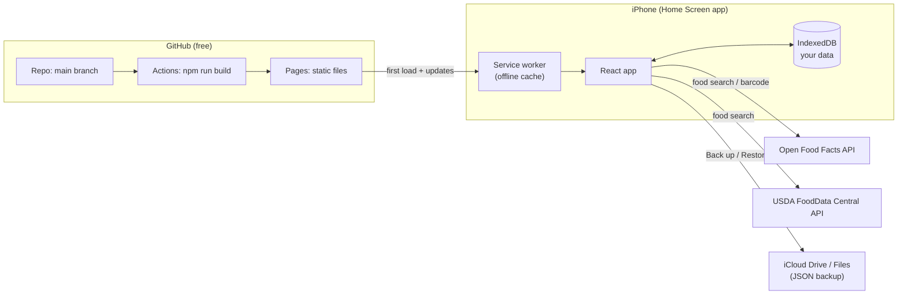
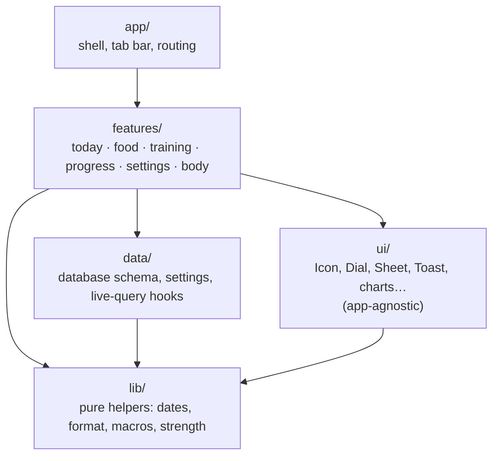
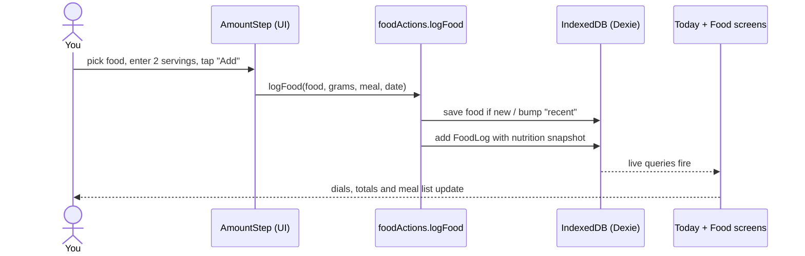
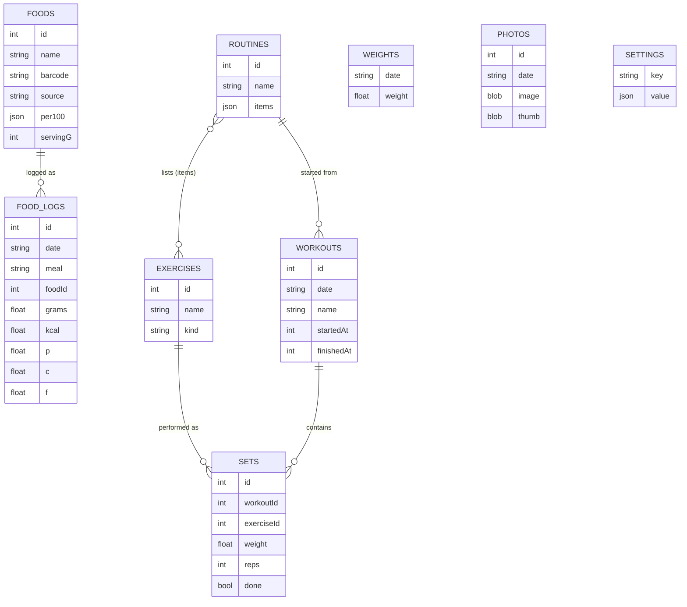

# MoveMent architecture

MoveMent is a **local-first web app**: all code ships to the phone once, and all data lives in the phone's browser database. There is no server of our own, which is why it costs nothing to run.

## 1. The big picture



- **GitHub Pages** only serves files. It never sees your data.
- The **service worker** caches the app so it opens offline and loads instantly.
- **IndexedDB** (through the Dexie library) is the database. It lives on the phone only.
- The only network calls are the two free food databases. Everything else works offline.

## 2. Layers

Code is split into five layers. Each layer may only import from the layers below it. `npm run build` runs `scripts/check-architecture.mjs`, which fails the build if a file breaks these rules.



| Layer | What lives there | May import |
|---|---|---|
| `app/` | `App.tsx` (screen switcher + tab bar), `routes.ts` | everything |
| `features/` | One folder per area of the app: screens, sheets, and that area's actions | `data`, `ui`, `lib`, its own folder, and `features/body` (shared) |
| `data/` | `db.ts` (tables + types), `settings.ts`, `hooks.ts` | `lib` |
| `ui/` | Reusable components with no app knowledge. Could be copied into any future project. | `lib` |
| `lib/` | Pure functions: no React, no database | nothing (type imports only) |

**Why:** features can't tangle into each other, `ui/` stays reusable for future apps, and the database is only touched in one predictable place per feature.

## 3. Inside a feature

Every feature follows the same pattern:

```
features/food/
├── FoodScreen.tsx      Screen: reads data with live queries, renders
├── EditLogSheet.tsx    Bottom sheets the screen opens
├── add/                A multi-step flow gets its own subfolder
│   ├── AddFoodSheet.tsx   (search → amount, scan → amount, or create)
│   ├── SearchStep.tsx  ScanStep.tsx  Scanner.tsx
│   └── AmountStep.tsx  CustomStep.tsx
├── components.tsx      Small pieces shared inside this feature only
├── foodActions.ts      ALL writes to the database for this feature
└── foodApi.ts          Talks to Open Food Facts and USDA
```

- **Screens and sheets read** data directly with `useLiveQuery(...)`.
- **Screens and sheets write** only by calling the feature's `*Actions.ts` functions.
- **Live queries re-render automatically** after any write, so there's no manual state syncing.

## 4. How one action flows: logging a food



The log stores its own calories and macros (a "snapshot"), so editing a food later never rewrites past days.

## 5. Data model



- Dates are stored as local `YYYY-MM-DD` strings, so a late-night snack lands on the right day.
- A workout with no `finishedAt` is the one in progress. Only one exists at a time.
- **Changing the schema:** add a new `this.version(2)` block in `data/db.ts`. Never edit version 1; phones that already have data upgrade step by step.

## 6. Where to put new things

| You're adding… | Put it in |
|---|---|
| A new area (e.g. Activity / Apple Health import) | `features/activity/` with its own screen and `activityActions.ts`, plus a tab in `app/routes.ts` |
| A new table | `data/db.ts` as a new schema version |
| A button style, chart type or other generic widget | `ui/`, using tokens from `styles/tokens.css` |
| A calculation (e.g. TDEE, pace) | `lib/` as a pure function |
| Something two features both need | `features/body/`-style shared feature, and list it in `SHARED_FEATURES` in the check script |
